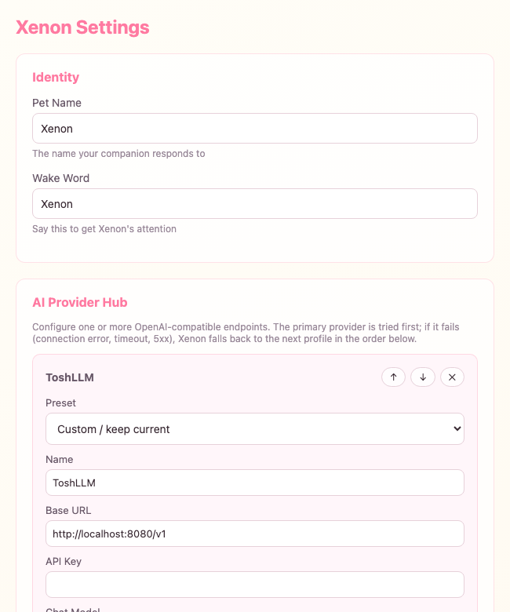
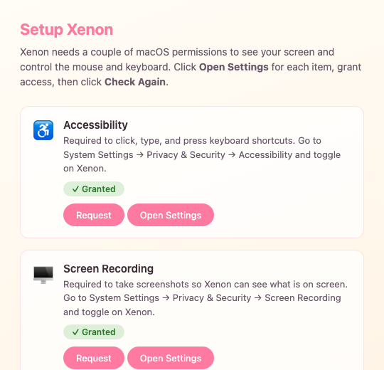
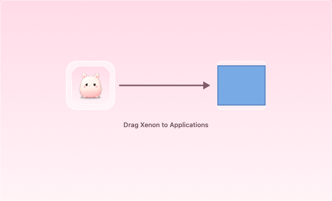

<div align="center">


**A local-first macOS menu-bar pet that listens, thinks, speaks, and drives your computer.**

[](#requirements)
[](#license)
[](https://github.com/sponsors/SamerKharboush)
[](https://paypal.me/Samerelnady)

[Install](#install) · [Features](#features) · [Screenshots](#screenshots) · [Models](#models) · [Providers](#providers) · [Agent & browser](#agent--browser) · [Building](#building) · [Testing](#testing)

</div>

---

Xenon is a small desktop companion living in your menu bar. It listens to your
voice, transcribes it locally with whisper-rs, thinks with an
OpenAI-compatible model of your choice, speaks back with neural TTS, and — when
you ask — drives your Mac with a hand-rolled ReAct agent loop. Everything runs
locally by default; cloud providers are opt-in per profile.

## Screenshots

The pet's five states, the settings window, and the first-run onboarding:

| Idle | Listening | Thinking |
| :---: | :---: | :---: |
|  |  |  |
| **Speaking** | **Agentic** | **Settings** |
|  |  |  |
| **Onboarding** | **DMG** | |
|  |  | |

## Features

A quick summary; the full PRD-vs-implementation table with measured evidence is
in [`docs/prd-conformance.md`](docs/prd-conformance.md).

- **Five-state pet** — Idle, Listening, Thinking, Speaking, Agentic. Menu-bar
  pet, click to tap, double-click for settings, drag to move. See
  [`CONTEXT.md`](CONTEXT.md) for the state glossary.
- **Local speech pipeline** — `cpal` capture → whisper-rs Silero VAD →
  whisper-rs STT (Metal on Apple Silicon, CPU fallback). Whisper loads lazily
  and unloads when idle.
- **Neural TTS** — sherpa-onnx Kokoro (or VITS/Piper), streamed per sentence
  with lip-sync, so the first sentence starts playing before the rest of the
  stream finishes. Falls back to the macOS `say` voice when no model is present.
- **Voice-first interaction** — hotkey talk (`Cmd+Shift+Space`) or wake-word
  mode, with a configurable wake phrase and sensitivity.
- **ReAct agent loop (ADR-0004)** — computer-control tools: `look`, `click`,
  `type_text`, `press_keys`, `scroll`, `open_app`, `wait`. Clicks use VLM
  grounding on a ≤512×512 screenshot mapped back to screen coordinates
  (Retina-aware). A verification screenshot is taken after each action; max
  steps configurable.
- **Provider Hub** — OpenAI-compatible profiles with configurable fallback
  order, vision model per profile, and one-click presets (see
  [Providers](#providers)).
- **Tool ecosystem** — MCP client (stdio + Streamable HTTP) with lazy start,
  per-server secrets in Keychain, and read-only import from Claude Desktop,
  Claude Code, Cursor, Windsurf, VS Code and OpenCode; built-in web tools
  (`web_search`, `web_extract`, `web_research`, `wikipedia`, `fetch_json`)
  with no key needed (DuckDuckGo → Brave/Tavily/Serper/SearXNG order).
  Settings → **Tools & MCP**. See [docs/adr/0008](docs/adr/0008-mcp-and-web-tools.md).
- **Performance-minded by default** — 320×320 light sprites, lazy audio, a
  15 FPS idle canvas, 2-worker tokio, and on-demand Settings/Onboarding
  windows. Idle footprint lands under 100 MB (see [Memory](#memory)).

## Install

Download the latest universal DMG from
[GitHub Releases](https://github.com/SamerKharboush/Xenon/releases/latest)
(`Xenon_<version>_universal.dmg`). It contains both Intel and Apple Silicon
slices. Each release also ships a zipped `Xenon.app` and a `SHA256SUMS` file.

Open the DMG and drag Xenon to Applications.

### Gatekeeper & re-granting permissions

The build is ad-hoc signed with a **stable identifier requirement**
(`designated => identifier "com.xenon.app"`), not a per-build cdhash — so
macOS TCC grants survive rebuilds and in-app updates. On first launch:

- macOS Gatekeeper still blocks the app because it isn't notarized: **right-click
  the app → Open**, then confirm. Do this once.
- **Users upgrading from v0.2.0 must re-grant Microphone and Screen Recording
  once.** The v0.2.0 build was cdhash-signed, so macOS treats it as a different
  app. After upgrading, re-open onboarding (or Settings → Permissions) and
  re-grant. This is a one-time step.

### First run

An onboarding window checks permissions and opens the relevant System Settings
panes, with a **Request** button where the OS allows an in-app prompt and an
**Open Settings** deep link everywhere:

- **Accessibility** — mouse/keyboard control (Settings pane only)
- **Screen Recording** — screenshots for grounding (requestable)
- **Microphone** — voice input (requestable)

If Microphone is denied, the audio worker keeps retrying on a backoff
(5 s → 30 s) and shows a precise message pointing at System Settings; it
recovers automatically once you grant access.

Then fetch the models and pick a provider.

## Requirements

- macOS 12 or later (Apple Silicon or Intel)
- For local models: ~1 GB free for the default whisper + VAD + TTS models
  (`scripts/fetch-models.sh`)

## Models

Run the fetch script to download default models:

```bash
scripts/fetch-models.sh
```

This installs `ggml-base.en` (whisper), `ggml-silero-v6.2.0` (VAD), and
`kokoro-en-v0_19` (TTS) into
`~/Library/Application Support/com.xenon.app/models/`. Paths are configurable in
Settings; by default whisper also picks up
`~/models/whisper/ggml-large-v3-turbo.bin` if present.

## Wake word

Xenon has two talk modes, picked in Settings:

- **Hotkey** (default) — hold/tap `Cmd+Shift+Space` to talk. Audio is fully
  lazy: no mic stream, no VAD, no STT until the hotkey.
- **Wake word** — the mic stays warm and VAD runs continuously; Xenon wakes when
  it hears your phrase. Say the phrase, then your command. A short chime plays
  on wake (configurable). After waking it listens for a command for up to 12 s
  (WAKE_LISTEN_TIMEOUT), capping a single wake utterance at 2.5 s.

The wake phrase is configurable (`wake_phrase`, default empty → the detector
listens for any speech), and `wake_sensitivity` (default 0.5) trades
false-wakes for missed wakes. Matching is text-fuzzy against the transcript, not
a separate keyword model.

## Voices

TTS runs through sherpa-onnx. Drop a model directory in Settings → TTS; Xenon
auto-detects the kind from the files:

- **Kokoro** (`kokoro-en-v0_19`) — multi-speaker, en; best quality/speed
- **VITS / Piper** — single-speaker fallback

Sentences are synthesised one at a time and streamed to playback, so the first
sentence starts while the rest is still being generated. `say` (macOS system
voice) is used automatically when no TTS model is configured.

## Providers

Provider Hub talks to any OpenAI-compatible `/v1` endpoint. Presets:

| Provider | Base URL | Key | Local |
| --- | --- | --- | --- |
| LM Studio | `http://localhost:1234/v1` | no | ✓ |
| ToshLLM | `http://localhost:8080/v1` | no | ✓ |
| XeonLLM | `http://localhost:18140/v1` | no | ✓ |
| Ollama | `http://localhost:11434/v1` | no | ✓ |
| 9router | `http://localhost:20128/v1` | yes | ✓ |
| OpenAI | `https://api.openai.com/v1` | yes | |
| NVIDIA | `https://integrate.api.nvidia.com/v1` | yes | |
| Anthropic | `https://api.anthropic.com/v1` | yes | |
| Gemini | `https://generativelanguage.googleapis.com/v1beta/openai` | yes | |
| OpenRouter | `https://openrouter.ai/api/v1` | yes | |
| Custom | your URL | — | |

Profiles can list a vision model and an agent model separately, and you order a
**fallback chain**: if the first provider errors or rate-limits, the next in the
list is tried automatically. Endpoints are validated (scheme, host, trailing
`/v1`) before save.

## Agent & browser

Ask Xenon to do something on the computer and the ReAct loop takes over
(ADR-0004):

1. `look` — capture the screen, downscale to ≤512×512, send to the vision model
2. the model replies with a tool call (click at (x,y), type text, press keys,
   scroll, open an app, wait)
3. `click` grounds the target on the screenshot (VLM → pixel → screen
   coordinates, Retina-aware) and synthesises the input
4. a verification screenshot is attached to every action result so the model
   can self-correct
5. repeat until done or `max_steps` (default 15)

The agent also has browser tooling (`browser.rs`) and a sandboxed script tool
(`scripts.rs`, disabled unless `allow_scripts` is on). Desktop control needs
Accessibility + Screen Recording; on this build the click path also triggers a
one-shot Screen Recording request on first use.

## Updates

Xenon checks GitHub Releases for a newer version 60 seconds after launch (if it
hasn't checked in the last 24 hours), then every 24 hours while running. When a
new version is found the pet shows a bubble and a tray item appears. Clicking it
downloads the DMG to `~/Downloads`, verifies its SHA-256 against the release's
`SHA256SUMS`, and opens it — you still drag it to Applications yourself. No
update is ever installed silently.

Settings → **Updates** lets you turn automatic checks off, force a check, see
the result, or **Skip this version**. See [RELEASING.md](RELEASING.md) for how
releases are cut.

## Configuration

Settings live in the app, backed by a config file at:

```
~/Library/Application Support/xenon/config.json
```

A corrupt config is backed up to `config.json.bak` before defaults are restored.
Configure provider endpoint, vision/agent models, model paths, listen mode, and
agent max steps from Settings.

### Hotkeys

- `Cmd+Shift+Space` — talk to / interrupt the pet
- `Cmd+Shift+Escape` — abort the agent turn and stop speech

### Tray menu

Show Pet · Talk · Settings · Quit

### Pet interactions

- Click — tap
- Double-click — open settings
- Drag — move the pet

## Building

Requires the Tauri v2 toolchain. From `src-tauri/`:

```bash
cargo tauri build --bundles app --target universal-apple-darwin
```

Then sign with the stable-identifier script and package a DMG from the **signed**
app (a plain `cargo tauri build --bundles dmg` would discard the signature and
reintroduce the TCC cdhash problem):

```bash
scripts/sign-app.sh src-tauri/target/universal-apple-darwin/release/bundle/macos/Xenon.app
scripts/make-dmg.sh src-tauri/target/universal-apple-darwin/release/bundle/macos/Xenon.app dist/Xenon_local.dmg
```

Output app:
`src-tauri/target/universal-apple-darwin/release/bundle/macos/Xenon.app`.

Icons and DMG background are generated via `scripts/gen-icon.swift` and
`scripts/gen-dmg.swift`; regenerate icons with
`cargo tauri icon src-tauri/icons/source.png`.

## Testing

```bash
cd src-tauri
cargo test
```

Real-model tests are marked `#[ignore]`:

```bash
cargo test -- --ignored
```

The mock MCP server (used by `mcp.rs` unit tests and `tests/mcp_mock.rs`) is
not a separate binary. Tests spawn their **own test executable** with a guarded
entry test (`current_exe --exact ...::mcp_mock_server_entry --nocapture` plus
`XENON_MCP_MOCK_CHILD=1`) and speak JSON-RPC over stdio. Nothing outside the
test binary is needed, so `cargo test` works on a clean checkout, and
`Xenon.app/Contents/MacOS/` stays clean so `codesign` succeeds.

### Stress harnesses

`scripts/stress/` holds the PRD-conformance harnesses and the results summary:

- `run-stt.sh` — whisper STT latency/accuracy (`out/stt-*.tsv`)
- `wake-cpu.sh` — wake-word true/false positive rates
- `run-tts.sh` — sherpa-onnx TTS + OOV + queue + fallback
- `run-providers.sh` — provider detection, model listing, fallback
- `soak.sh` — idle-memory soak over time
- `agent-tasks.py` — headless ReAct task runs (`--agent-task`)
- `ui-smoke.sh`, `check-commands.sh` — JS parse + invoke-command registration

Summaries and tails are recorded in [`docs/stress-report.md`](docs/stress-report.md);
raw output is gitignored under `scripts/stress/out/`.

## Architecture

- **Tauri v2**, 100% Rust backend, vanilla JS + Canvas UI (`src/pet/`)
- **whisper-rs** (Metal) for VAD + STT
- **sherpa-onnx** for TTS
- **OpenAI-compatible HTTP** provider hub
- **ReAct** agent loop (ADR-0004) with computer-control tools

Core modules (`src-tauri/src/`):

| Module | Role |
| --- | --- |
| `agent.rs` | ReAct agent loop |
| `audio.rs` | Audio pipeline (cpal + VAD + STT) |
| `audio_dsp.rs` | Audio DSP helpers |
| `browser.rs` | Agent browser tooling |
| `config.rs` | Config load/save, corrupt-config backup |
| `events.rs` | Shared types (AudioEvent, AgentAction, …) |
| `grounding.rs` | Screenshot → VLM → screen-point pipeline |
| `headless.rs` | Headless agent-task runner |
| `hub.rs` | Provider hub (profiles + fallback) |
| `lib.rs` | App entry/wiring |
| `main.rs` | Binary entry point |
| `permissions.rs` | Permission status/request + Settings deep links |
| `presets.rs` | Provider presets |
| `provider.rs` | Provider HTTP adapters |
| `runtime.rs` | Tokio task orchestration |
| `screenshot.rs` | Screen capture (+ one-shot Screen Recording request) |
| `scripts.rs` | Sandboxed agent script tool |
| `tools.rs` | Tool trait + implementations |
| `tts.rs` | TTS engine (sherpa-onnx) |
| `ui.rs` | Tauri window management (incl. lazy Settings/Onboarding windows) |
| `updater.rs` | In-app update check against GitHub Releases (download + SHA-256 verify) |

See `CONTEXT.md` for the glossary and `docs/adr/` for architecture decisions.

## Memory

Idle footprint, measured with `scripts/measure-ram.sh` (physical footprint per
process — RSS counts shared clean framework pages several times over):

```bash
scripts/measure-ram.sh [path-to-Xenon.app] [settle-seconds]
```

It launches the app, waits, prints the `footprint` of the `xenon` process plus
every WebKit XPC process the app just caused launchd to spawn, then a total, and
kills the app. Numbers are the 0.2.0 universal release build on macOS 14, ~15 s
after launch:

| Process | Idle (all toggles on) |
| --- | --- |
| `xenon` | ~32 MB |
| WebContent (pet) | ~13-17 MB |
| WebContent (onboarding, only while permissions are missing) | ~13 MB |
| WebKit GPU | ~18 MB |
| WebKit Networking | ~4 MB |
| **Total** | **~78-83 MB** (budget: < 100 MB) |

Grant Accessibility + Screen Recording and the onboarding process is never
created: total settles at ~67-70 MB. Active RAM with whisper/STT/TTS/LLM loaded
is several hundred MB — see `CONTEXT.md` ("Idle Shell" vs "Active with Models").

### Performance toggles

Settings → **Performance** exposes the three reductions, all **on** by default
(the budget-meeting configuration):

| Config key | Default | Toggles |
| --- | --- | --- |
| `light_sprites` | `true` | 320×320 sprites in `src/sprites/light/`, rare poses decoded on first use. Off: full-size 448×448 originals in `src/sprites/`, all preloaded (applies immediately) |
| `lazy_audio` | `true` | Mic, VAD and TTS stay unloaded until the hotkey; tokio runs on 2 workers. Off: capture + VAD preloaded at startup, TTS model loaded, default per-core tokio pool (applies after restart) |
| `idle_power_saver` | `true` | Idle draws at 15 FPS. Off: Idle draws at 60 FPS (CPU only, no RAM effect) |

## Support Xenon ♥

Xenon is free and open source (MIT). If it is useful to you, consider supporting
development:

- [GitHub Sponsors](https://github.com/sponsors/SamerKharboush)
- [PayPal](https://paypal.me/Samerelnady)

## Credits & license

Pet sprite artwork from [pet-mochi](https://github.com/cskwork/pet-mochi) (MIT,
© 2026 cskwork). Inspired by [Open-APA](https://github.com/laiye-ai/Open-APA)
(laiye-ai) and Personal-AI-Jarvis. See `THIRD_PARTY_NOTICES.md` for full
third-party license text.

MIT.